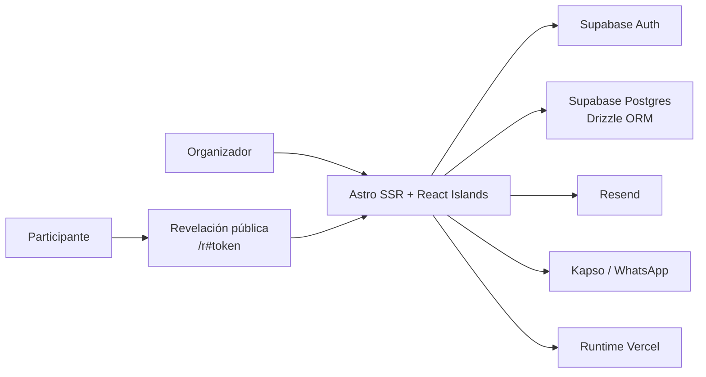

# Arquitectura

## Contexto

Secret Sánchez es una aplicación web SSR. El navegador utiliza páginas Astro y carga React solamente en los bloques
interactivos. El servidor aplica autenticación, ejecuta reglas de negocio, accede a Postgres y contacta con los
proveedores externos.

## Stack

- **Astro 7:** routing, SSR, layouts, endpoints y composición de páginas.
- **React:** islas interactivas en el navegador.
- **TypeScript:** contratos y tipos de aplicación.
- **UI:** shadcn/ui con preset `base-rhea`, Base UI y Tailwind CSS 4 mediante el plugin de Vite.
- **Drag and drop:** dnd-kit en la isla React de `/familia`, con superficies ordenables anidadas para unidades y participantes.
- **CSS:** tema y utilidades globales con CSS específico para layout y contenedores translúcidos.
- **Three.js:** escena WebGL cliente del fondo 3D ambiental, cargada desde el layout base.
- **Supabase Auth:** email, contraseña y sesión.
- **Supabase Postgres:** persistencia relacional.
- **Drizzle ORM:** schema y acceso tipado a la base.
- **Resend:** email transaccional.
- **Kapso:** plantillas de WhatsApp y webhooks firmados de estado.
- **Vercel:** adapter y despliegue serverless objetivo.
- **Zod:** validación de payloads de API.

## Capas

### Presentación

- `src/pages`: páginas Astro y endpoints.
- `src/layouts`: layouts base, administrativo y público.
- `src/components`: componentes Astro.
- `src/components/ThreeGiftBackground`: escena, carga del modelo y ciclo de vida del fondo 3D.
- `src/components/ui`: componentes React generados por shadcn/ui.
- `src/components/react`: estado e interacción cliente.
- `src/styles`: tokens, tipografía, animaciones y utilidades.

Las páginas deben preparar datos y componer vistas. No deben contener reglas complejas de sorteo o integración con
proveedores.

### Aplicación

`src/actions` representa casos de uso como mantener la familia, crear una edición, generar un intento o enviar notificaciones. Es el punto
adecuado para coordinar dominio, persistencia y proveedores.

Los casos de uso administrativos incorporan propiedad, bloqueos y transacciones. No se exponen escrituras directas de queries como acciones sin autorización.

### Dominio

- `src/services/draw`: reglas, generación y validación del sorteo.
- `src/services/notifications`: selección de canales y envío.

El motor de sorteo es independiente de Astro y de la base de datos. Esta separación debe conservarse para facilitar
pruebas.

### Persistencia

- `src/db/schema.ts`: schema relacional.
- `src/db/client.ts`: conexión Postgres.
- `src/db/queries`: operaciones de lectura y escritura.
- `drizzle`: migraciones generadas por Drizzle.
- `drizzle/meta`: snapshots versionados de las migraciones.

### Infraestructura

`src/lib` contiene entorno, hashing, tokens y clientes de Supabase, Resend y Kapso. Las claves privadas no deben
atravesar el límite del servidor.

## Flujos principales

### Acceso administrativo

1. El organizador envía email y contraseña a `/api/auth/login`.
2. El servidor valida las credenciales con Supabase y escribe las cookies SSR.
3. El middleware obtiene el usuario autenticado.
4. La aplicación busca primero su UUID en `admin_users.auth_user_id`.
5. Para una fila legacy aún no enlazada, usa el email como fallback y guarda el UUID de forma atómica.
6. Si está autorizado, permite acceder a las rutas administrativas.

### Sorteo objetivo

1. La aplicación resuelve la configuración de núcleos y participantes de la edición.
2. El dominio valida roles adultos, bebés, representantes, reglas y exclusiones.
3. Dentro de una transacción crea un intento numerado, snapshots de personas y unidades, asignaciones personales y de bebés y tokens.
4. El intento vigente alimenta las entregas y revelaciones.
5. Una revocación conserva la auditoría, invalida tokens y devuelve la edición a preparación.

### Revelación

1. El participante abre `/r#token`.
2. El cliente retira el fragmento y conserva el token en memoria; solicita preparación sin receptor.
3. El servidor busca por SHA-256 y comprueba la vigencia del intento.
4. Una acción explícita de apertura obtiene el receptor y registra la primera apertura atómicamente.

## Decisiones arquitectónicas vigentes

- SSR para mantener base de datos, claves y reglas sensibles en servidor.
- React solo donde aporta interacción.
- Tokens aleatorios con hash para búsqueda y ciphertext AES-256-GCM para entrega autorizada.
- Supabase obligatorio para la app; las guardas rechazan compartir Production desde desarrollo/Preview. El provisionamiento de proyectos independientes queda fuera del código.
- shadcn/ui y Tailwind CSS 4 como base de componentes; CSS propio limitado a composición y superficies.
- Textos de producto en español.
- No incorporar dependencias si la plataforma o los patrones existentes resuelven el problema.

Las decisiones aún abiertas están centralizadas en [decisions.md](./decisions.md).

El fondo Three.js se importa dinámicamente cuando el navegador queda libre. Pantallas pequeñas, ahorro de datos y movimiento reducido usan un regalo SVG estático sin descargar Three.js. Los recursos WebGL se liberan al salir y se reinicializan al restaurar una página desde la caché de navegación.

Las lecturas administrativas se acotan por pantalla: el historial no carga el censo, Familia no carga ediciones y la pantalla de sorteo no consulta entregas ni logs. Envíos obtiene el intento vigente sin cargar configuración ni censo. No existe caché global de datos privados entre usuarios.

La preparación pública obtiene únicamente identidad del regalador y apertura en una consulta. La apertura resuelve receptor y registra primera apertura mediante una sola sentencia SQL; mantiene un bloqueo compartido sobre el intento y exclusivo sobre la asignación, coordinándose con revocaciones sin serializar las aperturas de personas distintas.

## Casos de uso autorizados

Las rutas administrativas llaman a `adminData`, `editionData`, `editionRules`, `drawLifecycle` o `notifications`; no existen wrappers de escritura sin propietario ni un envío masivo alternativo sin reserva de intentos. `editionData` conserva las reexportaciones del ciclo de sorteo para compatibilidad interna. Las escrituras de censo adquieren primero el bloqueo de familia, antes de consultar o bloquear hijos; generación, revocación y reglas usan el mismo orden. Las consultas públicas de revelación proyectan únicamente la preparación o realizan la apertura atómica. La política de canales y formato de teléfono se comparte entre servidor y formularios en `src/lib/contact.ts`.
