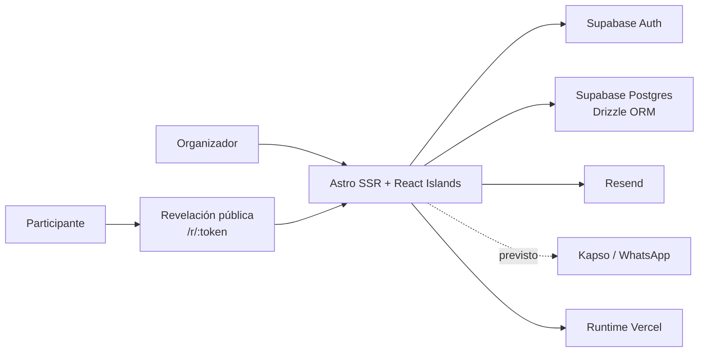

# Arquitectura

## Contexto

Secret Sánchez es una aplicación web SSR. El navegador utiliza páginas Astro y carga React solamente en los bloques
interactivos. El servidor aplica autenticación, ejecuta reglas de negocio, accede a Postgres y contacta con los
proveedores externos.

## Stack

- **Astro 5:** routing, SSR, layouts, endpoints y composición de páginas.
- **React:** islas interactivas en el navegador.
- **TypeScript:** contratos y tipos de aplicación.
- **UI:** shadcn/ui con preset `base-rhea`, Base UI y Tailwind CSS 4 mediante el plugin de Vite.
- **CSS:** tema y utilidades globales con CSS específico para layout y contenedores translúcidos.
- **Supabase Auth:** Magic Link y sesión.
- **Supabase Postgres:** persistencia relacional.
- **Drizzle ORM:** schema y acceso tipado a la base.
- **Resend:** email transaccional.
- **Kapso:** integración prevista de WhatsApp.
- **Vercel:** adapter y despliegue serverless objetivo.
- **Zod:** validación de payloads de API.

## Capas

### Presentación

- `src/pages`: páginas Astro y endpoints.
- `src/layouts`: layouts base, administrativo y público.
- `src/components`: componentes Astro.
- `src/components/ui`: componentes React generados por shadcn/ui.
- `src/components/react`: estado e interacción cliente.
- `src/styles`: tokens, tipografía, animaciones y utilidades.

Las páginas deben preparar datos y componer vistas. No deben contener reglas complejas de sorteo o integración con
proveedores.

### Aplicación

`src/actions` representa casos de uso como crear un grupo, generar un sorteo o enviar notificaciones. Es el punto
adecuado para coordinar dominio, persistencia y proveedores.

Algunas acciones actuales son reexportaciones directas de queries. Al conectar la UI deben incorporar autorización,
validación y transacciones donde corresponda.

### Dominio

- `src/services/draw`: reglas, generación y validación del sorteo.
- `src/services/notifications`: selección de canales y envío.

El motor de sorteo es independiente de Astro y de la base de datos. Esta separación debe conservarse para facilitar
pruebas.

### Persistencia

- `src/db/schema.ts`: schema relacional.
- `src/db/client.ts`: conexión Postgres.
- `src/db/queries`: operaciones de lectura y escritura.
- `drizzle`: migraciones generadas por Drizzle.
- `supabase/migrations`: migraciones destinadas a Supabase.

### Infraestructura

`src/lib` contiene entorno, hashing, tokens y clientes de Supabase, Resend y Kapso. Las claves privadas no deben
atravesar el límite del servidor.

## Flujos principales

### Acceso administrativo

1. El organizador solicita un Magic Link.
2. Supabase envía el enlace al callback de la aplicación.
3. El callback confirma la sesión y escribe cookies.
4. El middleware obtiene el usuario autenticado.
5. La aplicación valida su email contra `admin_users`.
6. Si está autorizado, permite acceder a las rutas administrativas.

### Sorteo objetivo

1. La aplicación carga participantes, reglas y exclusiones del grupo.
2. El dominio valida que el conjunto sea viable.
3. Genera un reparto.
4. Dentro de una transacción crea sorteo, asignaciones y tokens.
5. Entrega los enlaces o los usa inmediatamente para enviar notificaciones.
6. Bloquea el sorteo y actualiza su estado.

Los pasos 1, 4, 5 y 6 todavía no están conectados completamente.

### Revelación

1. El participante abre `/r/:token`.
2. El servidor calcula SHA-256 del token.
3. Busca la asignación por el hash.
4. Muestra el receptor y registra la primera apertura.

## Decisiones arquitectónicas vigentes

- SSR para mantener base de datos, claves y reglas sensibles en servidor.
- React solo donde aporta interacción.
- Tokens de revelación aleatorios; en base se almacena únicamente el hash.
- Datos demo aislados en `src/lib/demo.ts`.
- shadcn/ui y Tailwind CSS 4 como base de componentes; CSS propio limitado a composición y superficies.
- Textos de producto en español.
- No incorporar dependencias si la plataforma o los patrones existentes resuelven el problema.

Las decisiones aún abiertas están centralizadas en [decisions.md](./decisions.md).
