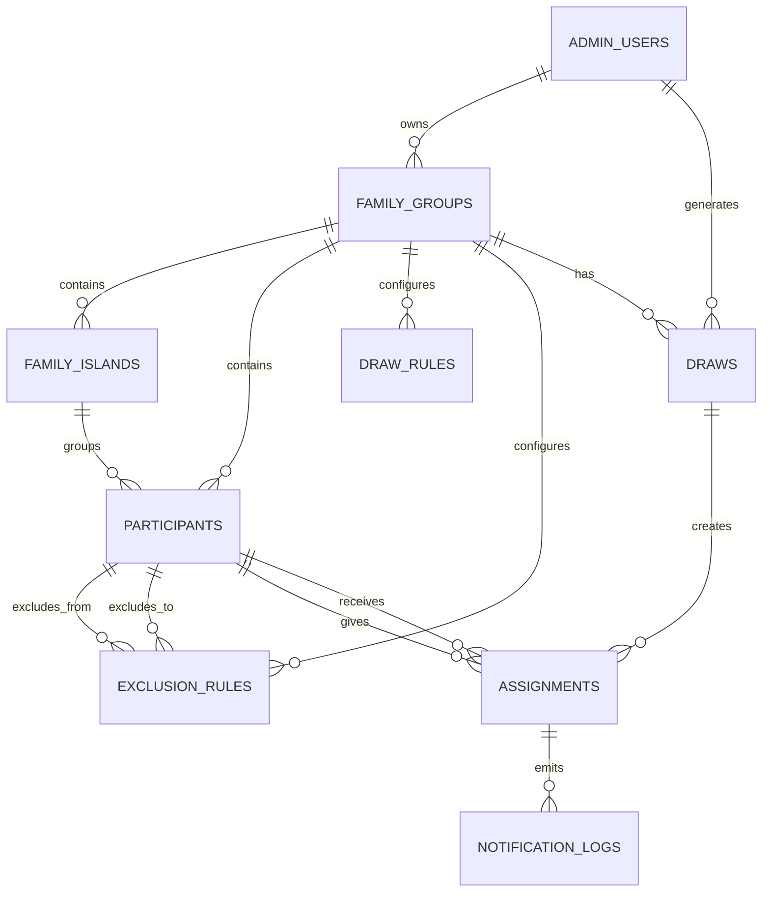

# Modelo de datos

El schema ejecutable está definido en `src/db/schema.ts`. Este documento explica su intención funcional; cualquier
cambio de columnas debe actualizar también el schema, la migración correspondiente y esta documentación.

## Diagrama

## Entidades

### `admin_users`

Allowlist de organizadores autorizados.

- `auth_user_id`: vínculo único con el usuario de Supabase Auth; permanece nullable para migrar filas antiguas.
- `email`: identificador de acceso y fallback temporal para filas que todavía no tienen `auth_user_id`; se normaliza a
  minúsculas y tiene índice único case-insensitive.
- `name`: nombre visible del administrador.

El primer administrador se crea de forma idempotente con `npm run admin:bootstrap`. En la primera sesión válida, la
aplicación enlaza atómicamente el UUID de Supabase cuando la fila legacy coincide por email y aún no estaba enlazada.

### `family_groups`

Una edición del evento para una familia y año.

- Pertenece a un administrador mediante `owner_admin_id`.
- `slug` es único.
- `year` permite conservar ediciones históricas.
- `status` expresa el ciclo de vida.
- `theme_config` reserva personalización visual futura.

### `family_islands`

Núcleo u hogar dentro de un grupo.

- Pertenece a un grupo.
- Tiene nombre, color y descripción opcional.
- Al eliminar el grupo, sus núcleos se eliminan en cascada.

### `participants`

Persona del grupo.

- Pertenece tanto al grupo como a un núcleo.
- Email y teléfono son opcionales.
- `active` permite excluir temporalmente sin borrar.
- `can_give` y `can_receive` modelan participación asimétrica, aunque el algoritmo actual exige igual número de
  personas que regalan y reciben.
- `preferred_channel` selecciona email, WhatsApp, ambos o manual.

Antes de insertar o mover un participante debe validarse que `group_id` coincide con el grupo del núcleo.

### `draw_rules`

Reglas configurables del grupo. El tipo implementado en dominio es `NO_SAME_ISLAND`; `config` permite guardar
parámetros adicionales.

La creación de un grupo inserta por defecto esta regla activada y la generación la carga desde Postgres.

### `exclusion_rules`

Prohíbe una asignación dirigida concreta:

`from_participant_id` no puede regalar a `to_participant_id`.

La dirección importa. Si la exclusión debe ser mutua se necesitan dos registros. Todavía no existe mantenimiento
desde la UI.

### `draws`

Ejecución concreta del sorteo.

- Pertenece a un grupo y año.
- Puede registrar quién lo generó.
- `seed` está reservado, pero el algoritmo actual usa aleatoriedad criptográfica y no lo rellena.
- Su estado permite separar generación, bloqueo y envío.

### `assignments`

Relación secreta entre participante que regala y participante que recibe.

- Pertenece a un sorteo.
- `reveal_token_hash` es SHA-256 del token y es único.
- `reveal_token_ciphertext` conserva una copia cifrada con AES-256-GCM para envío y entrega manual.
- Las filas antiguas pueden tener ciphertext nulo porque el token original no es recuperable.
- `opened_at` registra la primera apertura.

Se deben añadir garantías de unicidad por sorteo para `giver_id` y `receiver_id`, o mantenerlas de manera
transaccional y validada en aplicación. Actualmente el schema no tiene esos índices compuestos.

### `notification_logs`

Intento de notificación asociado a una asignación.

- Canal: email, WhatsApp o manual.
- Destinatario utilizado en el intento.
- Estado, identificador del proveedor, error y fecha de envío.

`idempotency_key` evita repetir un intento por reenvío de la misma petición.

## Estados

### Grupo

| Estado | Significado previsto |
| --- | --- |
| `draft` | Configuración en curso. |
| `ready` | Participantes y reglas validados. |
| `drawn` | Existe un sorteo generado. |
| `sent` | Se completó la entrega prevista. |
| `archived` | Edición histórica cerrada. |

### Sorteo

| Estado | Significado previsto |
| --- | --- |
| `draft` | Registro todavía no definitivo. |
| `generated` | Asignaciones creadas. |
| `locked` | No admite regeneración accidental. |
| `sent` | Notificaciones procesadas. |

La transición entre estados aún no está implementada como máquina de estados. No debe asumirse que el valor actual
garantiza que las operaciones asociadas hayan ocurrido.

### Notificación

`pending`, `sent`, `delivered`, `failed`, `opened` y `manual`.

No todos estos estados tienen todavía una fuente de eventos. `delivered` y `opened` requerirán definir webhooks o
una semántica más precisa.

## Eliminación y conservación

- Eliminar un grupo elimina en cascada núcleos, participantes indirectamente relacionados, reglas, sorteos y
  asignaciones según las claves existentes.
- No existe UI de borrado ni política de retención.
- Para el MVP se debe preferir archivar el grupo y desactivar participantes frente al borrado físico.

## Migraciones

Drizzle es la única fuente operativa. Los SQL y snapshots se versionan en `drizzle/`; nunca se ejecutan
automáticamente durante el build de Vercel.
