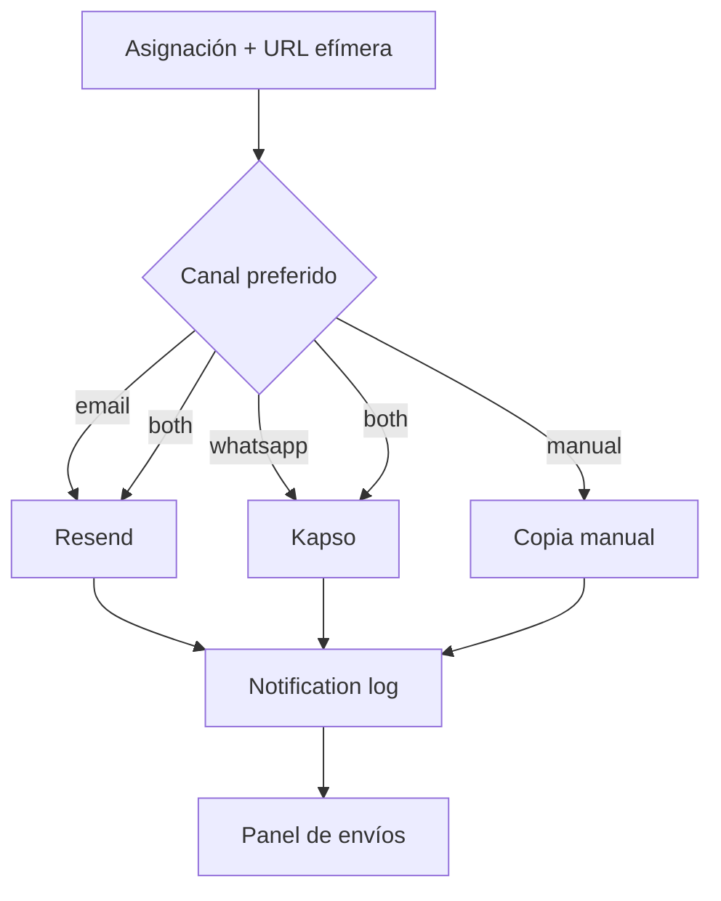

# Notificaciones

## Objetivo

Entregar a cada participante su enlace secreto por el canal elegido, permitir entrega manual y ofrecer al organizador
un estado fiable de cada intento.

## Preferencias

| Preferencia | Comportamiento previsto |
| --- | --- |
| `email` | Enviar email si existe dirección. |
| `whatsapp` | Enviar WhatsApp si existe teléfono. |
| `both` | Intentar ambos canales disponibles. |
| `manual` | No enviar automáticamente; ofrecer copia segura. |

Si falta el contacto requerido, el participante debe aparecer como pendiente de corrección o entrega manual.

## Email

`sendEmailNotification` usa Resend y prepara texto y HTML con:

- Saludo al participante.
- Enlace de revelación.
- Aviso para no compartirlo.

Requisitos antes de producción:

- Configurar `RESEND_API_KEY`.
- Verificar el dominio del remitente.
- Confirmar la dirección `from`.
- Probar enlaces con el `APP_URL` de producción.
- Registrar resultado, identificador de proveedor y error.
- Definir reintentos sin duplicar envíos innecesariamente.

## WhatsApp

El servicio construye el mensaje, pero `sendKapsoMessage` es actualmente un stub. Incluso con `KAPSO_API_KEY`
responde como integración pendiente.

Queda por decidir:

- API y autenticación definitivas de Kapso.
- Plantillas aprobadas por WhatsApp.
- Formato y normalización internacional del teléfono.
- Webhooks de entrega y fallo.
- Límites, costes y reintentos.
- Consentimiento y privacidad aplicables.

## Entrega manual

Debe permitir copiar la URL una vez generada y marcar la asignación como entregada manualmente. La pantalla demo ya
incluye la acción de copiar, pero no persiste el estado manual.

El organizador nunca debería tener que ver el receptor para compartir el enlace.

## Logs

Cada intento debería crear un `notification_logs` con:

- Asignación.
- Canal.
- Destinatario usado.
- Estado inicial `pending`.
- Identificador del proveedor si existe.
- Error normalizado.
- Fecha de envío.

Los webhooks o consultas posteriores actualizarían `delivered`. La apertura real de la revelación vive hoy en
`assignments.opened_at`; antes de usar también el estado `opened` en notificaciones debe definirse su significado.

## Idempotencia y reintentos

- Cada acción de reintento debe identificar el intento original.
- Un timeout desconocido no equivale necesariamente a un fallo definitivo.
- Debe evitarse enviar varias veces por doble clic.
- El reintento masivo debe operar solo sobre estados elegibles.
- Corregir un contacto no debe modificar el sorteo.
- Los errores visibles deben ser comprensibles y conservar el detalle técnico en servidor.

## Flujo objetivo

## Privacidad

Los logs pueden contener email o teléfono, pero nunca el token o URL completos. Las respuestas del proveedor y los
mensajes de error deben sanearse antes de guardarse o registrarse.
